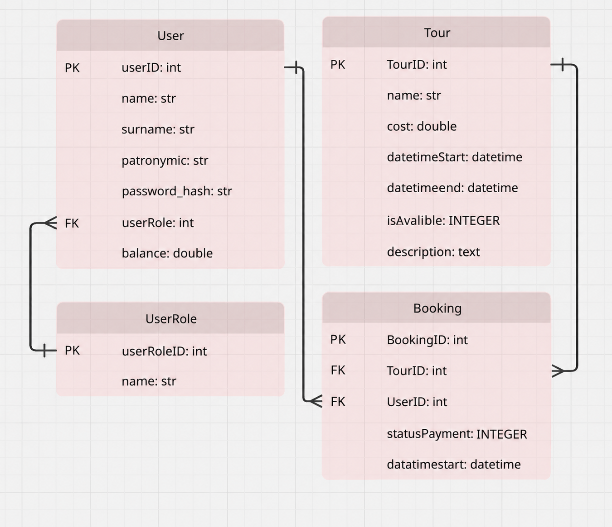

# Система учета туристических путевок

## Описание проекта
Система предназначена для автоматизации работы туристического агентства, ведения базы данных туров, управления клиентами и обработки бронирований туров.

## Архитектура и стек технологий
- **Язык программирования:** Python
- **База данных:** SQLite

## Роли пользователей в системе
1. **Клиент:**  авторизация, просмотр каталога туров, выбор тура, бронирование и оплата путевки, просмотр истории своих броней.
2. **Менеджер:** авторизация, подтверждение бронирований, оформление продаж, просмотр общего списка броней.
3. **Администратор:** авторизация, полное управление турами (добавление, изменение, удаление), управление учетными записями пользователей.

## Структура проекта
- `src/` — исходный код приложения 
- `docs/diagrams/` — блок схемы и USE CASE ДИАГРАММА

## База данных и архитектура (ЛР №3)
Проект использует реляционную базу данных **SQLite**. Структура спроектирована на основе ER-диаграммы и включает 4 основные таблицы:
1. **`UserRole`** — справочник ролей пользователей (Клиент, Менеджер, Администратор)[cite: 5].
2. **`User`** — таблица учетных записей пользователей с привязкой к ролям и балансом[cite: 5].
3. **`Tour`** — каталог доступных туристических путевок и туров[cite: 5].
4. **`Booking`** — таблица бронирований, реализующая связь между пользователями и турами (многие-ко-многим)[cite: 4, 5].

### ER-диаграмма базы данных
Ниже представлена схема базы данных, созданная для проекта:

## Инструкция по запуску
1. Откройте терминал и перейдите в папку inf-lab2 с помощью команды: cd inf-lab2
2. Затем перейдите в папку src с помощью команды: cd src
3. Запустите приложение командой: py main.py