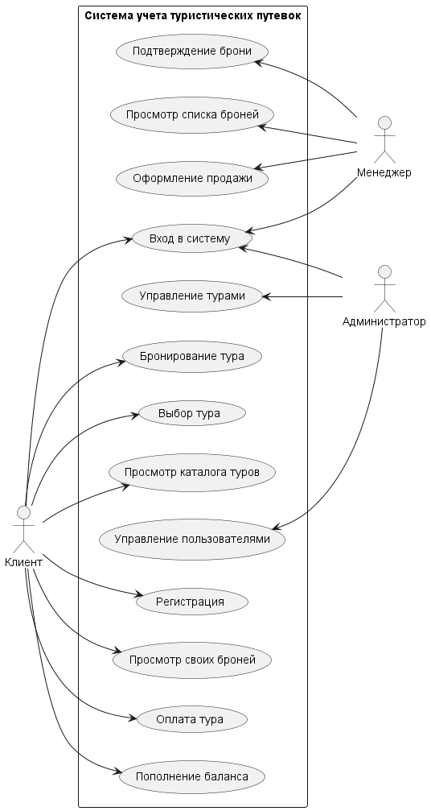
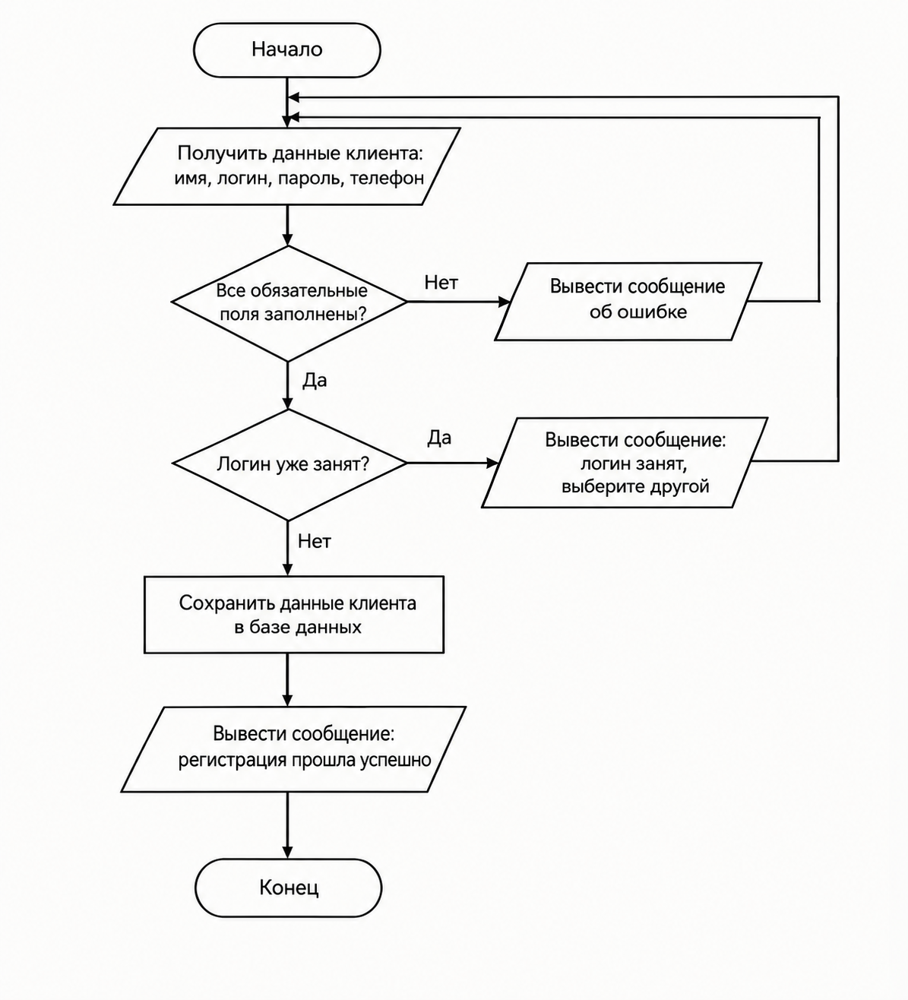
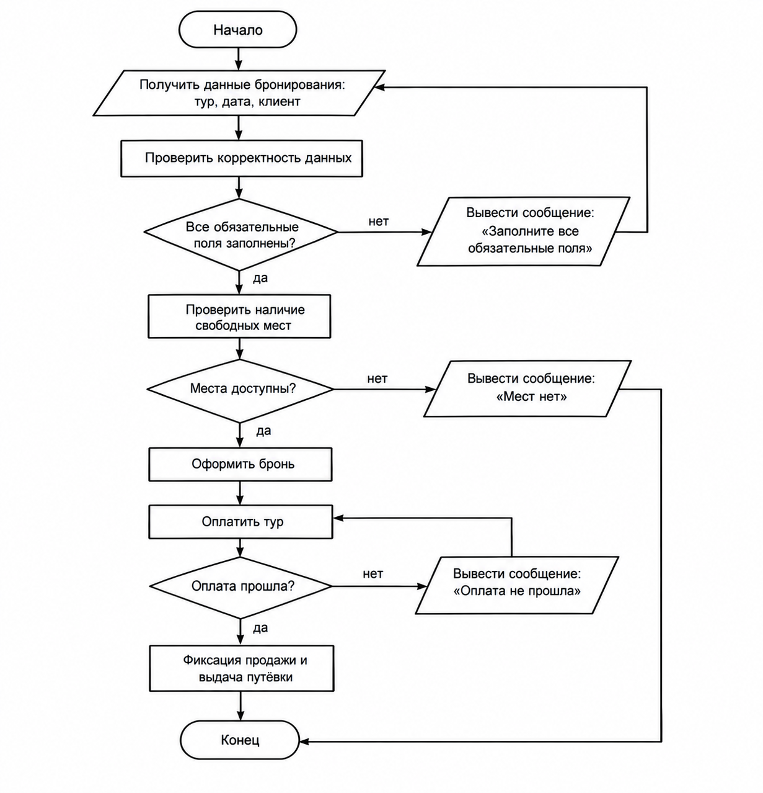
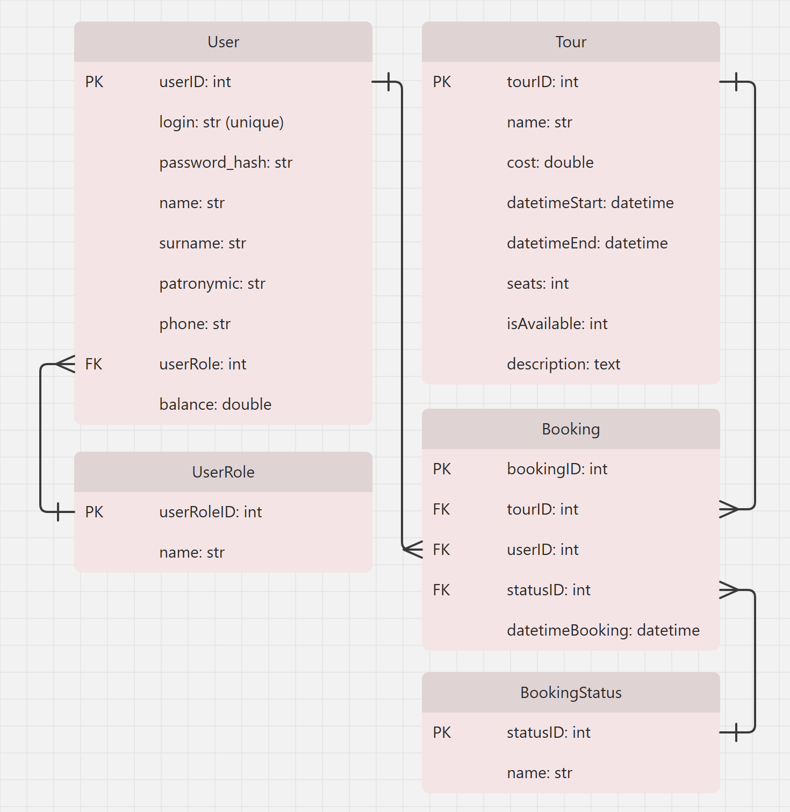

# Система учета туристических путевок

Консольное приложение для туристического агентства. Хранит каталог туров, позволяет клиентам бронировать и оплачивать путевки, а сотрудникам — подтверждать брони и управлять турами.

## Цели системы

- автоматизировать бронирование и продажу путевок;
- следить за наличием свободных мест в турах;
- хранить историю бронирований клиентов;
- разграничить доступ по ролям.

## Роли пользователей

| Роль | Что может делать |
|------|------------------|
| **Клиент** | регистрация, вход, просмотр каталога, бронирование тура, пополнение баланса, оплата, просмотр своих броней |
| **Менеджер** | вход, подтверждение брони, оформление продажи, просмотр всех броней |
| **Администратор** | вход, управление турами и пользователями |

## Технологии

- **Язык:** [Python](https://www.python.org/)
- **База данных:** [SQLite](https://www.sqlite.org/)
- **Диаграммы:** [PlantUML](https://plantuml.com/)
- **Архитектура:** многослойная — интерфейс, бизнес-логика, слой данных

## Структура проекта

```
├── README.md
├── schema.sql            # таблицы и тестовые данные
├── init_db.py            # создание базы данных
├── src/travel_agency/
│   ├── main.py           # точка входа: главное меню и вход
│   ├── constants.py      # номера ролей и статусов брони
│   ├── database/         # подключение к базе
│   ├── models/           # модели данных (dataclass)
│   ├── repositories/     # SQL-запросы, CRUD-операции
│   ├── services/         # бизнес-логика и проверки
│   └── ui/               # консольное меню для каждой роли
└── docs/diagrams/        # диаграммы
```

## Слои приложения (ЛР №4)

| Слой | Папка | Что делает |
|------|-------|------------|
| Интерфейс | `ui/` | показывает меню, принимает ввод, выводит результат и ошибки |
| Бизнес-логика | `services/` | проверяет данные и права, например «хватает ли денег на оплату» |
| Доступ к данным | `repositories/` | выполняет SQL-запросы и возвращает модели |
| Модели | `models/` | описывают записи таблиц как объекты Python |

Интерфейс обращается только к сервисам, а SQL-запросы есть только в репозиториях.

**Путь брони:** Создана → Оплачена (клиент платит с баланса) → Подтверждена (менеджер оформляет продажу). Бронь в статусе «Создана» или «Оплачена» можно отменить, деньги за оплату возвращаются на баланс.

## Use Case диаграмма

Показывает, какие действия доступны каждой роли. Исходник: [use_case.puml](docs/diagrams/use_case.puml).



## Блок-схемы процессов

**Регистрация клиента**



**Покупка тура**



## База данных

Скрипт создания таблиц и тестовых данных: [schema.sql](schema.sql).

| Таблица | Что хранит |
|---------|------------|
| `User` | пользователи: логин, пароль (хеш), ФИО, телефон, роль, баланс |
| `UserRole` | роли: Клиент, Менеджер, Администратор |
| `Tour` | туры: название, цена, даты, количество мест |
| `Booking` | брони: кто, какой тур, когда, статус |
| `BookingStatus` | статусы брони: Создана, Оплачена, Подтверждена, Отменена |

### ER-диаграмма



## Запуск

1. Создать базу данных:
   ```bash
   python init_db.py
   ```
2. Запустить программу:
   ```bash
   python src/travel_agency/main.py
   ```


